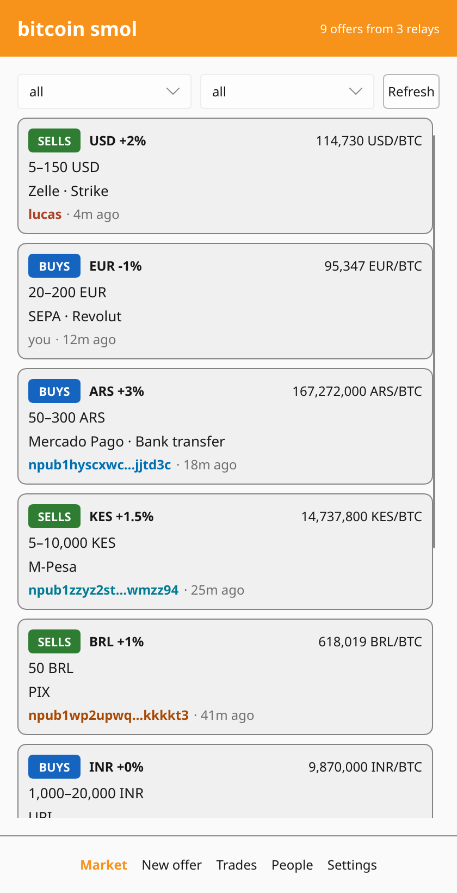
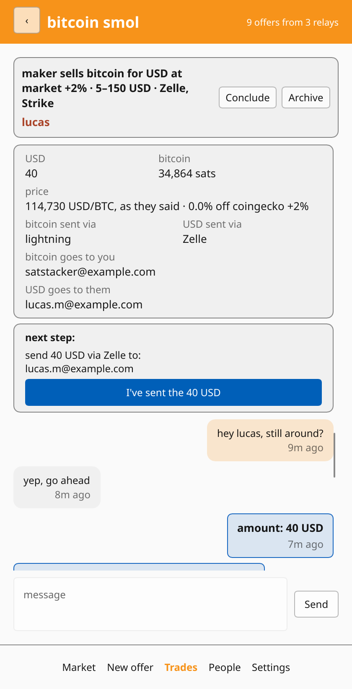
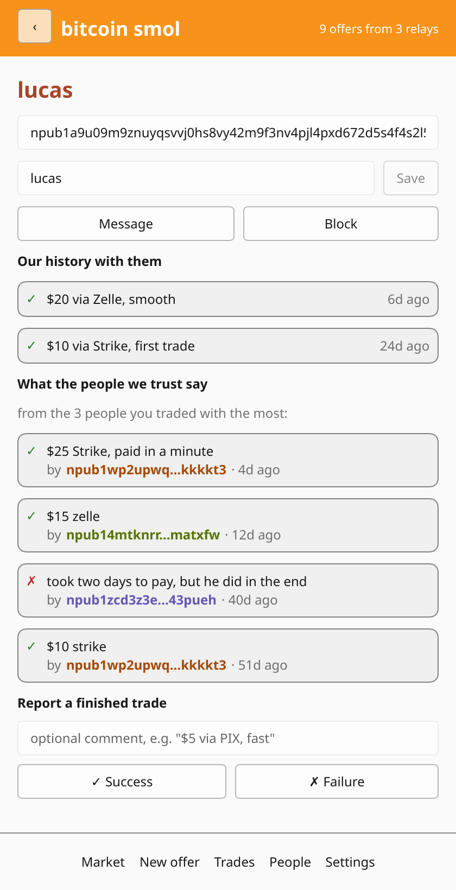
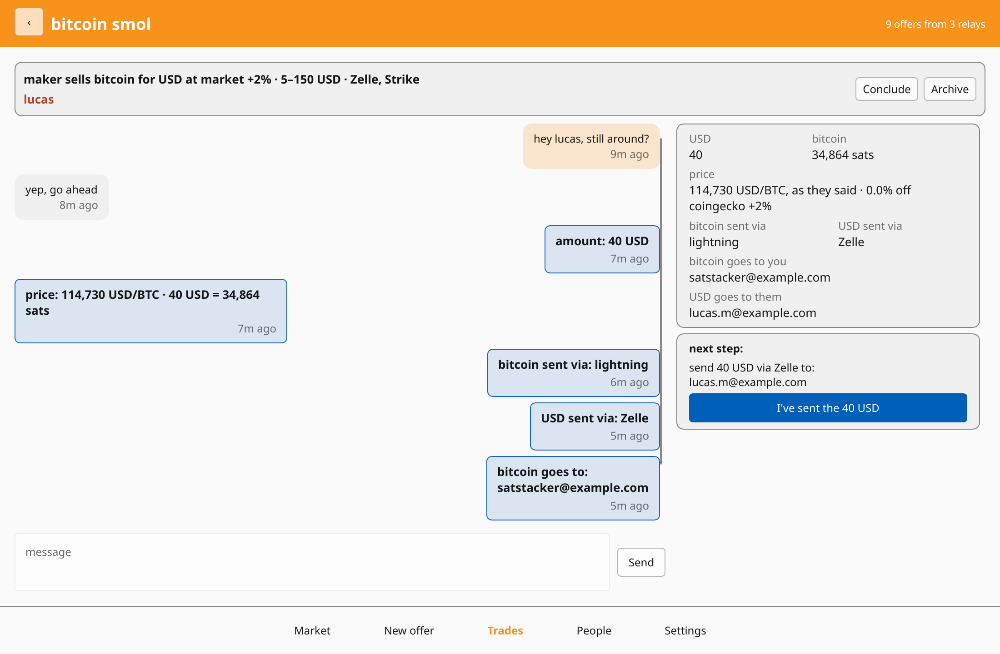

# bitcoin-smol

A tiny peer-to-peer market for exchanging bitcoin and fiat over nostr.

There is **no escrow, no arbiter, no usernames and no server**. Every trade is based on trust alone. Start with
ridiculously small amounts, like $2. Build a history of trades, increase the amounts slowly, and never go too high.

<p>
  
  
  
</p>

The user guide lives in `docs/` and is published to <https://andunieee.github.io/bitcoin-smol/> on every push to
`master` (`zola --root docs serve` to preview it). This README is about the protocol and the code.

## How it works

### Identity

The app generates a nostr secret key on first launch and stores it on the device.
Your npub is your only identity. Offers carry no username or profile, only the npub that signed them. You can reveal the
nsec in Settings to back it up, or import an nsec you used before. Importing is refused while there are open offers or
ongoing trades, since those belong to the current key. The replaced key is kept as `key.<pubkey>.old`.

### Offers (kind `6012`)

An offer is a regular event of kind `6012`. Its `content` is a free-form description, such as hours or
conditions. The terms go in tags:

```jsonc
{
  "kind": 6012,
  "content": "I'm usually online in the evenings",
  "tags": [
    ["side", "sell"],                  // the maker "sell"s or "buy"s bitcoin
    ["currency", "USD"],               // fiat currency to exchange for bitcoin
    ["price_api", "coingecko"],        // where the market price comes from
    ["premium", "+1%"],                // price relative to the market price, absent means "+0%"
    ["amount", "20", "100"],           // min and max, in the fiat currency
    ["payment", "Strike"],             // payment methods, one tag each, free-form
    ["payment", "Zelle"],
    ["bitcoin", "lightning"],          // how the bitcoin side is settled, one tag each
    ["bitcoin", "liquid"],
    ["relay", "wss://nostr.wine/"],    // where the DM negotiation happens, one or more
    ["relay", "wss://nostr.land/"],
    ["expiration", "1791345600"]       // NIP-40, at most 3 hours after created_at
  ]
}
```

- **`side`** isn't in the original list of terms, but an offer means nothing without it. It is always from the maker's
  point of view.
- **`currency`**: the app hardcodes a list of currencies (USD, EUR, GBP, MXN, ARS, VES, COP, …).
- **`price_api`**: each currency lists the APIs that can quote it, and the app has a fetch function for each:
  `coingecko`, `yadio`, `kraken`, `bitstamp` and `mempool` (see `src/prices.rs`). Clients that don't know an API id
  show the offer with an "unknown price api" warning.
- **`premium`**: the actual price is a variation over the market price. `"+1%"` means bitcoin is bought or sold 1% more
  expensive than the market price, and `"-2%"` means 2% cheaper. If the tag is absent, the premium is 0%.
- **`amount`**: how much of the fiat currency the maker trades, anything from the min to the max. Both are positive
  decimal numbers and min can't be more than max; equal values (or a single value) mean a fixed amount. Offers
  without it are ignored.
- **`payment`**: free-form. The app offers a hardcoded list similar to RoboSats (Revolut, Wise, Zelle, Strike, SEPA,
  UPI, Mercado Pago, M-Pesa, gift cards, Cash F2F, …) plus a text field for anything else.
- **`bitcoin`**: how the maker accepts or sends bitcoin. The app offers `onchain`, `rootstock`, `lightning`, `cassis`,
  `arkade` and `liquid`, and requires at least one. These only show in the focused offer view, not in the offer list.
- **`relay`**: the relays where the taker and maker exchange DMs about this offer.
- **`expiration`**: offers live for at most 3 hours. Clients only fetch offers from the last 3 hours
  (`since: now - 3h`) and discard any offer whose expiration has passed or is more than 3 hours after its `created_at`.
  To keep an offer up, publish it again.

The app remembers which relays accepted each of your offers. Closing an offer before it expires sends a NIP-09
deletion (kind `5`, with `["e", <offer id>]` and `["k", "6012"]`) to those relays.

### Relays

The app uses a set of "app relays" to discover and publish new offers and trade reports. By default this is only `nostr.wine`, a paid relay, so identities are not free. The Settings menu lets you switch relays on and off, remove them, and add your own.

### DMs: a shared-key scheme (kinds `8021` and `28022`)

This is a new scheme, not NIP-17 or NIP-04.

1. Both parties compute the same **conversation key** from NIP-44:
   `conversation_key = hkdf_extract(salt="nip44-v2", ecdh(my_sk, their_pk))`.
   It is 32 bytes, so it is also a valid secp256k1 secret key. Its public key is the **conversation pubkey**.
2. A message starts as an unsigned kind `14` **rumor**, as in NIP-17/NIP-59:
   `{id, pubkey: <real author>, created_at, kind: 14, tags: [["p", <recipient>], ["e", <offer id>]], content}`.
3. The rumor is NIP-44-encrypted with the conversation key. The result goes into the `content` of a kind `8021` event,
   which is **signed with the conversation key**. So the event's `pubkey` is the conversation pubkey. Its only tag is a
   NIP-40 `["expiration", <created_at + 30 days>]`.
4. That event is published to the relays from the offer announcement.

Consequences:

- **Deniability.** Either party could have signed any message, since both know the conversation key. No message can
  be provably attributed to either side, not even to the other party in the conversation. The only way to know which
  messages are yours is to remember them, so the app keeps a local cache of the ids of the rumors it created. Any other
  message in the conversation is from the other party.
- **Opt-in listening and instant blocking.** To receive messages from someone you subscribe to
  `{"kinds": [8021], "authors": [<conversation pubkey>]}`. You only see DMs from people you chose to listen to.
  Blocking someone just means not making that subscription anymore. Their messages never reach you, and the relay
  doesn't know who you blocked.
- **No public metadata.** Relays and observers only see a pubkey nobody has seen before, posting encrypted blobs. They
  can't tell which two people are behind it.

#### Pings (kind `28022`)

The maker can't subscribe to a conversation pubkey without knowing who the taker is. So to start a conversation, the
taker sends a **ping**: a kind `28022` event signed with the taker's real key, whose only tag is `["p", <maker>]`. It
means "look, there is a DM for you from me." It goes to the offer's relays.

The maker's app listens for `{"kinds": [28022], "#p": [<me>]}` on the app relays and on the negotiation relays of the
maker's recent offers. When a ping arrives from someone who isn't blocked, the app derives the conversation pubkey and
subscribes to it. Pings from blocked npubs are ignored.

Kind `8021` is a regular event, so relays store DMs and the other side doesn't need to be online when you send one.
Each DM expires 30 days after it was sent: relays that support NIP-40 drop it then, and clients
ignore it. Messages the app has already received stay in its local cache.

Kind `28022` is in the ephemeral range, so relays forward pings to live subscribers but don't store them. Until the
other side has replied, the app sends a fresh ping with each message and waits a moment before publishing the message.
That gives the other side time to subscribe.

### Labels

You can give anyone a label from their profile, such as "fast UPI guy" or "alice from the meetup". Labels are stored
only on your device and never published. A labeled key shows its label in the order book, in your trades and in trade
reports, and the People tab lists everyone you labeled, with a search.

### The trade

The whole trade happens in the DM: amounts, payment details, the invoice or address, who goes first. Nothing about it
is public, nothing is escrowed, and nobody can step in if it goes wrong. That's why the app keeps reminding you to
start small.

A trade starts when you contact a maker, or when a taker pings you. There is one ongoing trade per peer, since the
conversation key belongs to the pair of keys. The Trades tab lists your open offers, your ongoing trades and your past
ones. When a trade is over you can:

- **conclude** it, which publishes a trade report (below),
- **archive** it, which keeps it in your history without a report,
- or **delete** it, which forgets it.



Ending a trade stops the app from listening to that conversation. If the same person starts a new trade later, it
only shows messages from after it started. DMs stay on relays for 30 days, so older ones would otherwise come back.

#### Structured trade messages

Some messages in a trade's chat are made by buttons, not typed. They are ordinary rumors whose `content` says in
plain English what happened, and which carry the same thing as data in a `trade` tag:

```jsonc
["trade", "amount", "50"]                  // "Let's trade 50 USD."
["trade", "price", "61234.56"]             // "The price is 61,234 USD/BTC, so 50 USD is 81,650 sats."
["trade", "bitcoin-method", "lightning"]   // "Let's send the bitcoin via lightning."
["trade", "payment-method", "Zelle"]       // "Let's send the USD via Zelle."
["trade", "bitcoin-details", "lnbc1…"]     // "Send the bitcoin to: …", from whoever receives the bitcoin
["trade", "payment-details", "me@zelle"]   // "Send the USD to: …", from whoever receives the fiat
["trade", "sent"]                          // "I've sent the 50 USD." / "I've sent the bitcoin."
```

Both sides replay these, in order, on top of the offer's terms, to get the same state of the deal (`src/deal.rs`).
The taker picks the amount and the methods among what the offer allows. A fixed amount is sent as soon as the taker
contacts the maker, and methods the offer leaves no choice about are decided from the start. The maker's app answers
the amount with the price of a bitcoin: the market price from the offer's `price_api` plus its `premium`, at that
moment. That price is the one the trade uses. The taker's app checks it against its own fetch from the same source and
flags it when it is more than 1% off. Then each side gives the details for what they receive, the taker sends their part first and
says so, and the maker sends theirs after that. Each value is set once. Actions from the wrong side, out of order,
or outside the offer's terms are ignored. The maker learns which offer the trade is about from the `e` tag on the
taker's messages.

### Trade reports (kinds `8022` and `8020`)

When a trade is over, either party can publish a report about the other:

```jsonc
{ "kind": 8022, "tags": [["p", "<other party>"]], "content": "$5 via UPI, fast" }  // success
{ "kind": 8020, "tags": [["p", "<other party>"]], "content": "never paid" }        // failure
```

Reports are signed with your real key. The app stores them in a local event database and publishes them to current app relays.

### Deciding who to trust

When you open someone's profile, the app shows:

1. **Your history with them**: every `8020` or `8022` that *you* wrote about them, read from the local database.
2. If you have fewer than 20 of those, **what the people you trust say**. The app ranks the people you have reported
   successful trades with (your own `8022`s) by number of reports, takes the top 10, and asks your relays for
   `{"kinds": [8020, 8022], "authors": [<those 10>], "#p": [<this person>]}`. It shows any results with their authors
   and caches them locally.

So there is no global score that can be gamed. Everything is local and relative: the more you trade, the bigger your
web of people whose opinion you can rely on. A newcomer with no history has to start small, and so does anyone dealing
with a newcomer.

## Code layout

| file              | what                                                                                                                    |
| ---               | ---                                                                                                                     |
| `src/protocol.rs` | event kinds, offer encoding and decoding, the conversation-key DM scheme, pings, reports                                |
| `src/prices.rs`   | hardcoded currencies, price APIs and their fetch functions, premium parsing                                             |
| `src/store.rs`    | key, json state (relays, open offers, ongoing trades, rumor ids, blocklist, labels), redb event database, trust queries |
| `src/form.rs`     | defaults for the new offer form, from the locale and your last offers                                                   |
| `src/deal.rs`     | structured trade messages, and the state of a deal replayed from them                                                   |
| `src/history.rs`  | past trades, in redb                                                                                                    |
| `src/app.rs`      | relay subscriptions, publishing, and the glue to the UI                                                                 |
| `src/app/screenshots.rs` | renders the screenshots in `docs/static/screenshots` offscreen, over made-up data                                |
| `ui/app.slint`    | the interface: market, offer, new offer, trades, trade, profile, people, settings                                       |
| `src/lib.rs`      | Android entry point (`android_main`)                                                                                    |
| `src/main.rs`     | desktop entry point, and the web entry point when built for wasm                                                        |
| `web/index.html`  | the page for the web build, with the canvas the app draws into                                                          |

## Building

On the desktop, for development:

```sh
cargo run                 # data goes in ~/.local/share/bitcoin-smol (%APPDATA% on windows), or set $BITCOIN_SMOL_DATA
cargo test
```

The screenshots in `docs/static/screenshots` come from the real UI, rendered offscreen by Slint's software renderer
over made-up offers, trades and reports, with nothing sent to the network. Run `just screenshots` to update them
after changing the UI.

For Android you need the Android SDK and NDK (`ANDROID_HOME` and `ANDROID_NDK_ROOT` set) and
[cargo-apk](https://crates.io/crates/cargo-apk):

```sh
rustup target add aarch64-linux-android armv7-linux-androideabi
cargo apk run --lib       # builds, installs and launches on a connected device
cargo apk build --lib --release
```

The APK settings (package name, SDK versions and the `INTERNET` permission) are under `[package.metadata.android]` in
`Cargo.toml`.

For the web you need [trunk](https://trunkrs.dev):

```sh
rustup target add wasm32-unknown-unknown
trunk serve web/index.html                                   # on http://127.0.0.1:8080
trunk build web/index.html --release --dist target/web       # a static site, to host anywhere
```

The databases need the origin private file system, which browsers only give to pages served over https or from
localhost. `.github/workflows/pages.yml` publishes the web build at <https://andunieee.github.io/bitcoin-smol/app/>,
next to the user guide.

### Releases

Pushing a `v*` tag runs `.github/workflows/release.yml`. It builds binaries for Linux (x86_64, aarch64), macOS
(aarch64, x86_64) and Windows (x86_64), plus the APK, and attaches them to a GitHub release. The APK is signed with the
keystore in the `ANDROID_KEYSTORE_BASE64` and `ANDROID_KEYSTORE_PASSWORD` repository secrets. Without them it is signed
with a throwaway key, so Android won't install the next release over it.
